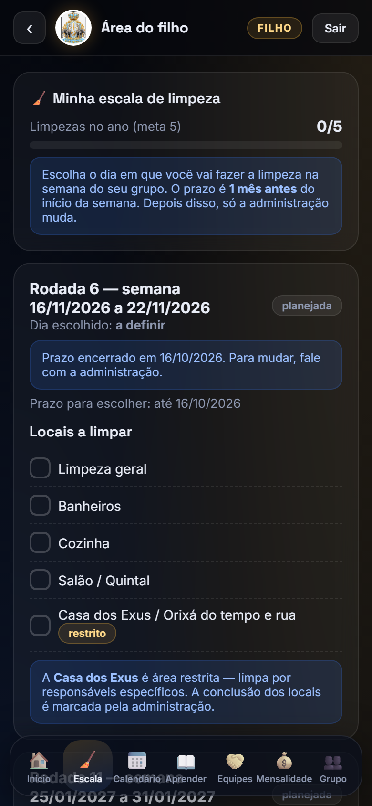
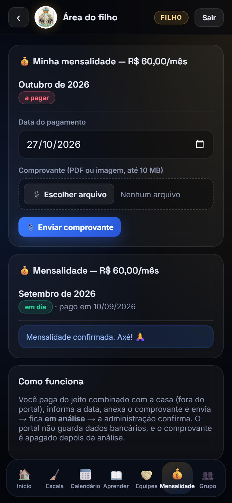
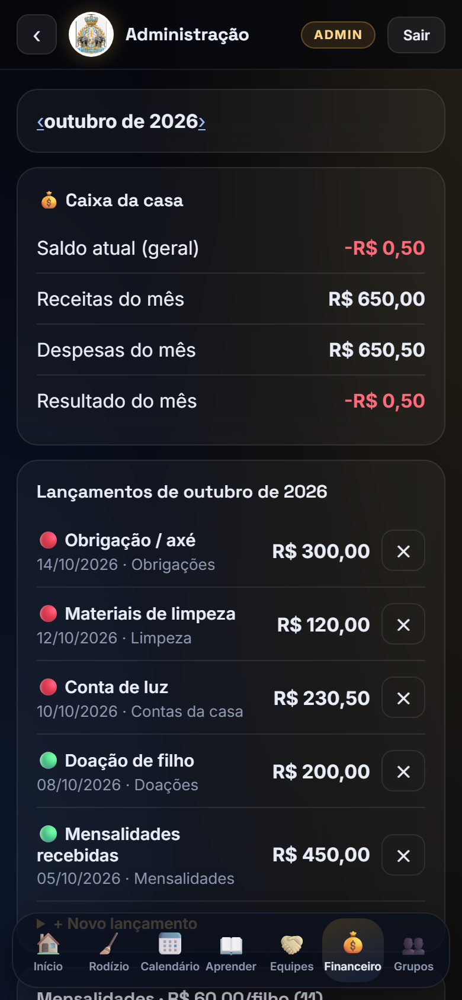
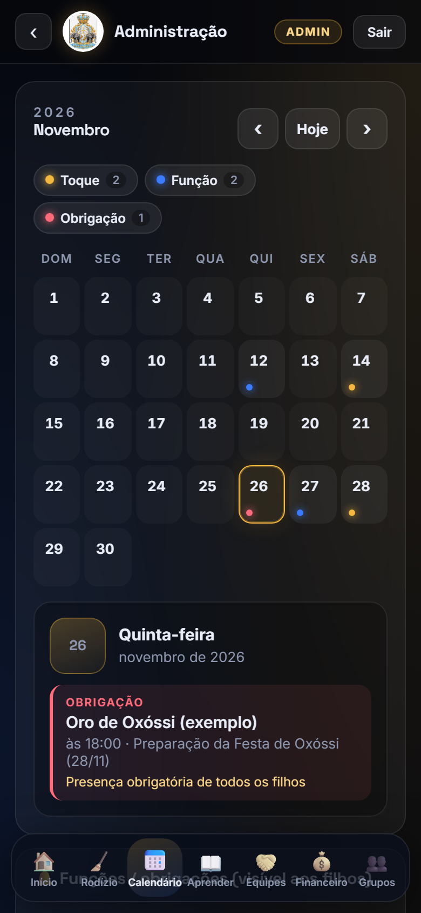

# Portal Família Àṣẹ Omos Odé

**Site público e área restrita para filhos e administração do Centro Cultural Família Àṣẹ Omos Odé**
São Paulo — SP · Fundado em 25/04/1980 · Odé/Oxóssi, Oxum e Obaluaê (Azauani)

> Versão de apresentação · 27/10/2026 · As telas mostram **dados fictícios** de demonstração.

---

## 1. O que é

Um portal único, que funciona no **computador e no celular** (pode ser instalado na tela inicial como
um aplicativo, sem passar pela loja de apps):

- **Site público** da casa: história, Orixás, calendário de toques, fotos e vídeos das festas,
  agendamento de jogo de búzios pelo WhatsApp e localização.
- **Área restrita** com login, onde cada filho acompanha a sua vida na casa e a administração organiza
  tudo num só lugar.

O visual segue exatamente o esboço aprovado no vídeo **"Esboço Portal"**.

## 2. Problemas que resolve

| Antes | Com o portal |
|---|---|
| Escala de limpeza em planilha, combinada no grupo de mensagens | Rodízio quinzenal automático por grupo; cada filho escolhe o seu dia; meta de **5 limpezas por ano** acompanhada |
| Comprovantes de mensalidade e festa espalhados no WhatsApp | Filho envia o comprovante no portal; a administração confirma com um toque; o arquivo é apagado depois |
| Dias de função e toques avisados de boca | **Calendário de funções** (cada função com seu dia e responsáveis) e **calendário de toques** |
| Caixa da casa em caderno | **Controle financeiro**: entradas, saídas, saldo e resultado do mês |
| Fichas dos filhos em papel | Cadastro completo (Cadastro Geral + Cadastro de filho), sempre à mão |

## 3. Site público

- Topo com a foto da casa e **"fé, axé e tradição"** (texto editável pela administração).
- **Mais de 45 anos de FÉ**, **Nossos Orixás**, **Próximos toques**, **Fotos e vídeos das festas**,
  **Jogo de búzios** (abre o WhatsApp da casa com a mensagem pronta — nada é enviado sozinho) e **Onde estamos**.
- **Calendário de toques** mês a mês, aberto a visitantes:

## 4. Área do filho

O filho **vê**: funções e obrigações (com aviso de presença obrigatória nos Oros e se ele está escalado),
as próximas semanas do seu grupo, a situação da mensalidade e das festas, os próximos toques,
os aniversariantes do mês, os colegas do grupo (só nomes) e os seus dados.

O filho **faz só três coisas** (regra da casa):

1. **Escolhe o dia da limpeza** na semana do seu grupo — até **1 mês antes**.
2. **Envia o comprovante da mensalidade** (PDF ou foto).
3. **Envia o comprovante da contribuição da festa**.

| Escala | Calendário | Mensalidade |
|---|---|---|
|  |  |  |

Os dados pessoais são **somente leitura** para o filho: correções são feitas pela administração.

## 5. Administração

- **Comprovantes para analisar** logo na entrada; confirmar ou recusar (com motivo que o filho vê).
- **Rodízio**: gera as rodadas do ano, marca os locais limpos, vê e ajusta o dia de cada filho, acompanha
  quem está abaixo da meta de 5 limpezas.
- **Controle financeiro** do terreiro: saldo geral, receitas e despesas do mês, lançamentos por categoria,
  mensalidades do mês (lançadas automaticamente todo dia 1º).
- **Calendário de funções e toques**: cadastra cada função com dia, hora e quem vai fazer; os toques
  podem aparecer no site público.
- **Festas**: cria a festa com o valor por filho e acompanha quem já contribuiu.
- **Filhos (cadastro)**, **Grupos**, **Áreas restritas** (ex.: Casa dos Exus), **Galeria**, **Aparência do site**
  e **Auditoria** (registro de quem fez o quê).

| Financeiro | Calendário | Rodízio |
|---|---|---|
|  |  |  |

## 6. Acesso e segurança

- **Entrar com Google** ou com **e-mail e senha** (com confirmação por e-mail).
- **Só entra quem a administração cadastrou.** Ter conta no Google não basta: o portal confere o cadastro.
- Cada filho **vê só os próprios dados** e os nomes do seu grupo. Isso é garantido **pelo banco de dados**,
  não só pela tela — testado automaticamente a cada mudança (24 verificações de permissão).
- Comprovantes ficam em **área privada** e são **apagados** depois da análise.
- O portal **não guarda** dados bancários, cartão, Pix nem senha de banco. Pagamentos continuam fora do portal.
- **Termo de consentimento** (LGPD) aceito no primeiro acesso; aniversário guardado só com dia e mês.

## 7. Qualidade por trás do portal

- **Esteira de desenvolvimento seguro (DevSecOps)**: a cada mudança, o código passa automaticamente por
  busca de senhas vazadas, análise de segurança do código, verificação de bibliotecas vulneráveis, testes,
  análise de qualidade, varredura da imagem e teste de invasão básico (OWASP ZAP). Falhas **altas ou
  críticas bloqueiam** a publicação.
- **Testes automáticos**: unitários, de permissão do banco e de ponta a ponta (navegador simulando o filho e o administrador).
- **Monitoramento**: painel com site no ar, banco, tempo de resposta e alertas automáticos.
- **Rotinas automáticas**: mensalidades do mês e limpeza dos comprovantes, sem ninguém precisar lembrar.

## 8. Próximos passos

| Etapa | Quem |
|---|---|
| Revisar as telas e textos (história da casa, fotos, vídeos) | Casa |
| Decidir o endereço do site (domínio) e a hospedagem | Casa + equipe técnica |
| Ligar o "Entrar com Google" (passo a passo pronto em `GUIA-LOGIN-GOOGLE.md`) | Equipe técnica |
| Cadastrar os filhos (e-mail de cada um) e os grupos | Administração da casa |
| Publicar e enviar o aviso aos filhos pelo WhatsApp (texto pronto no guia) | Casa |
| Revisão de segurança e LGPD antes de colocar os dados reais | Equipe técnica |

### Custos (o que é gratuito e o que é pago)
- **Gratuitos**: login com Google; plano gratuito do Supabase (banco, login e arquivos) para começar.
- **Pagos**: domínio (`.com.br`, anual) e hospedagem do portal. Os valores mudam — consultar na hora da contratação.
- Nenhuma contratação foi feita: tudo roda hoje no ambiente de desenvolvimento.

---
*Axé! 🙏*
