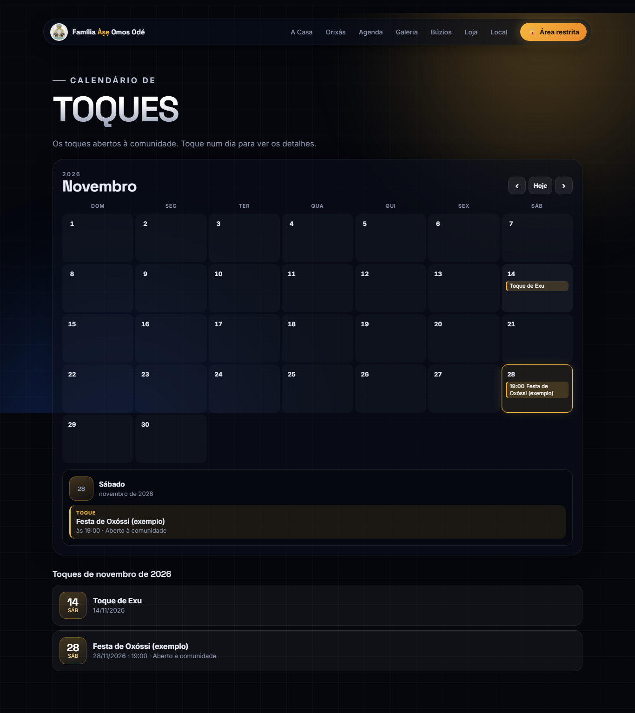
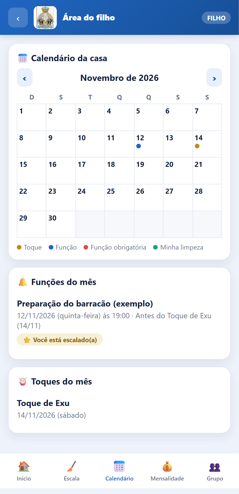
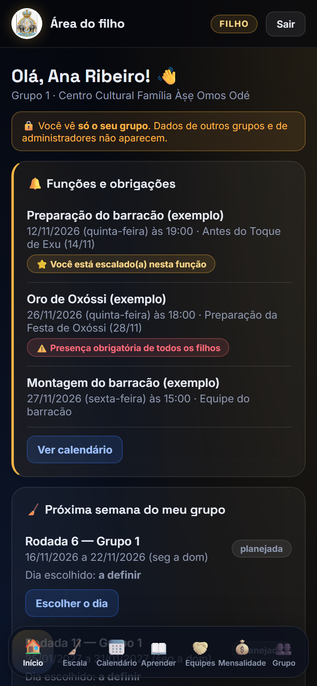
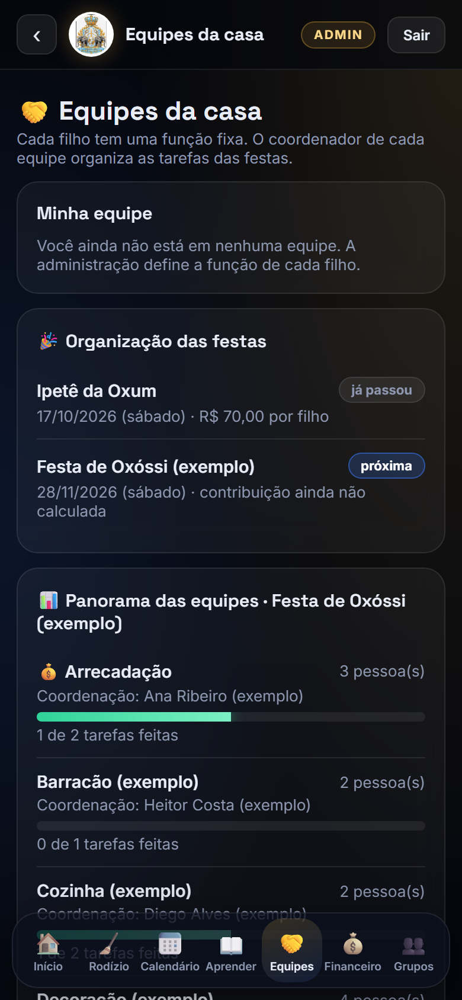
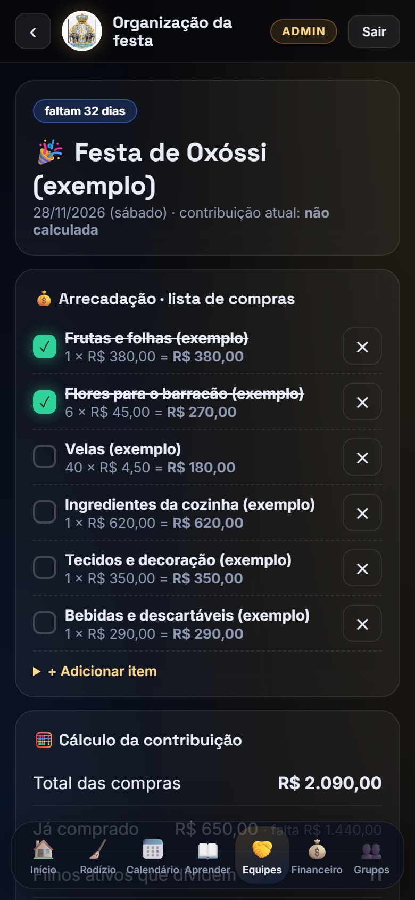
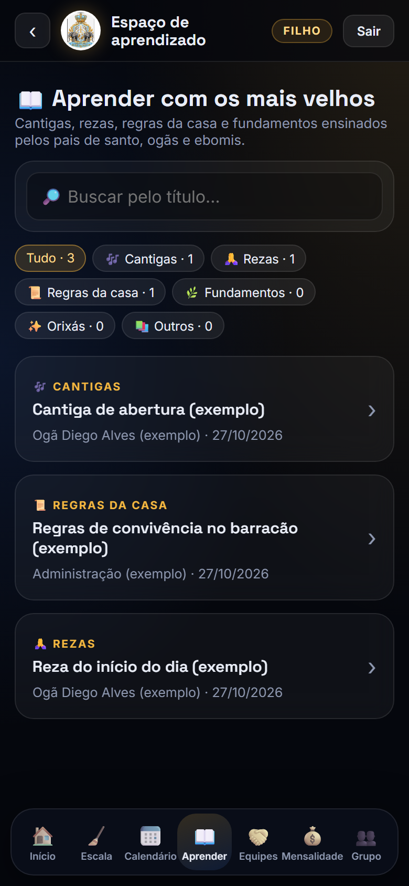
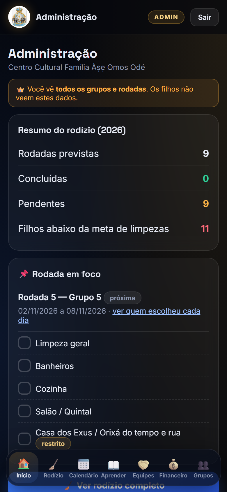
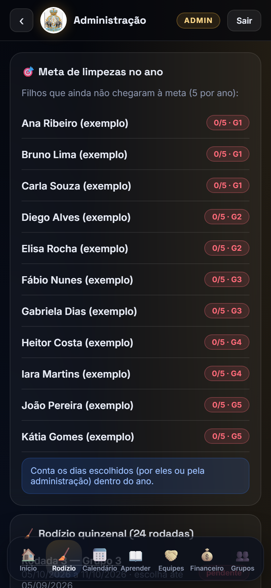

# Portal Família Àṣẹ Omos Odé

**Site público e área restrita para filhos e administração do Centro Cultural Família Àṣẹ Omos Odé**
São Paulo — SP · Fundado em 25/04/1980 · Odé/Oxóssi, Oxum e Obaluaê (Azauani)

> Versão 2 · 27/10/2026 · PDF: `APRESENTACAO-CLIENTE.pdf` (fonte: `apresentacao/apresentacao.html`).
> As telas usam **dados fictícios** de demonstração (marcados “exemplo”); o portal real começa sem dados de exemplo.

---

## 1. O que é

Um portal que funciona no **computador e no celular** (instalável na tela inicial, sem loja de apps):

- **Site público:** história, **calendário de toques**, fotos e vídeos das festas, jogo de búzios pelo
  WhatsApp e localização. Visual escuro e tecnológico; o topo mostra o **próximo toque** e quantos dias faltam.
- **Área restrita** com login: cada filho acompanha a sua vida na casa; administração e coordenadores organizam tudo.

## 2. Problemas que resolve

| Antes | Com o portal |
|---|---|
| Escala de limpeza em planilha e grupo de mensagens | Rodízio quinzenal por grupo; cada filho escolhe o seu dia; meta de **5 limpezas por ano** |
| Comprovantes espalhados no WhatsApp | Filho envia no portal; a administração confirma; o arquivo é apagado depois |
| Toques, funções e obrigações avisados de boca | **Calendário mensal** com cada compromisso no seu dia, cores por tipo e detalhes ao tocar |
| Conta da festa no papel | **Arrecadação**: lista de compras, total e divisão automática pelos filhos ativos |
| Funções na festa pouco claras | **Equipes** com coordenador e tarefas por festa, com andamento |
| Cantigas, rezas e regras só de boca | **Espaço de aprendizado** publicado por pais/mães de santo, ogãs e ebomis |
| Caixa em caderno, fichas em papel | Controle financeiro e cadastro completo |

## 3. Site público

Seções: A Casa · Calendário de toques · Galeria · Jogo de búzios (abre o WhatsApp com a mensagem
pronta — nada é enviado sozinho) · Onde estamos. Textos, cor e fotos são alterados pela administração.

## 4. Calendário

| Cor | Tipo |
|---|---|
| 🟡 | **Toque** — os públicos aparecem também no site |
| 🔵 | **Função** — com responsáveis |
| 🔴 | **Obrigação** — presença obrigatória (todo “Oro” já entra assim) |
| 🟢 | **Minha limpeza** — só o próprio filho vê |

Tocar num dia abre os detalhes; os botões da legenda ligam e desligam cada tipo.

| Filho | Administração |
|---|---|
|  |  |

## 5. Área do filho

| Início | Escala | Mensalidade |
|---|---|---|
|  |  |  |

O filho **vê** funções e obrigações (presença obrigatória, se está escalado), as semanas do seu grupo,
mensalidade e festas, toques, aniversariantes, colegas do grupo (só nomes), a sua equipe e os seus dados.

O filho **faz**: escolhe o dia da limpeza (até 1 mês antes); envia o comprovante da mensalidade e das festas;
se for da equipe, marca as tarefas da festa. Dados pessoais são somente leitura. Botão **Sair** no topo de todas as telas.

## 6. Equipes, arrecadação e aprendizado

| Equipes | Arrecadação | Aprendizado |
|---|---|---|
|  |  |  |

- **Equipes:** cada filho tem uma função fixa; cada equipe tem um coordenador, que cria as tarefas de cada festa.
  O panorama mostra o andamento de todas.
- **Arrecadação:** o coordenador monta a lista de compras; o portal soma e divide pelos filhos ativos, sempre
  para cima. Ex.: R$ 2.090,00 ÷ 42 = R$ 49,77 → **R$ 50,00** por filho. Quem já pagou não é alterado.
- **Aprendizado:** cantigas, rezas, regras e fundamentos; publicam pais/mães de santo, ogãs, ebomis e a administração.

## 7. Administração

| Início | Financeiro | Rodízio |
|---|---|---|
|  |  |  |

Comprovantes para analisar, rodízio, financeiro (mensalidades lançadas todo dia 1º), calendário, festas,
equipes, cadastro dos filhos (equipe e cargo), grupos, áreas restritas, galeria, aparência do site e auditoria.

## 8. Acesso, privacidade e qualidade

- Entrar com **Google** ou **e-mail e senha**; **só entra quem a administração cadastrou**.
- Cada pessoa vê só o que lhe cabe — garantido **pelo banco de dados** (37 verificações automáticas de permissão).
- Comprovantes privados e apagados após a análise; sem dados bancários, cartão ou Pix; termo de consentimento (LGPD).
- Esteira DevSecOps a cada mudança (segredos, código, bibliotecas, imagem, testes, OWASP ZAP): **falha alta ou
  crítica bloqueia**. 24 testes unitários e testes de ponta a ponta. Monitoramento com alertas.

## 9. Próximos passos

| Etapa | Quem |
|---|---|
| Revisar telas e textos (história, fotos, vídeos) | Casa |
| Cadastrar filhos, grupos e equipes (com coordenadores) | Administração |
| Definir quem tem cargo de ensino (pai/mãe de santo, ogã, ebomi) | Administração |
| Domínio e hospedagem | Casa + equipe técnica |
| Ligar o “Entrar com Google” (`GUIA-LOGIN-GOOGLE.md`) | Equipe técnica |
| Revisão de segurança/LGPD e publicação | Equipe técnica |
| Aviso aos filhos pelo WhatsApp | Casa |

**Custos:** gratuitos — login Google e plano gratuito do Supabase; pagos — domínio `.com.br` (anual) e hospedagem.
Nenhuma contratação foi feita.

---
*Axé! 🙏*
